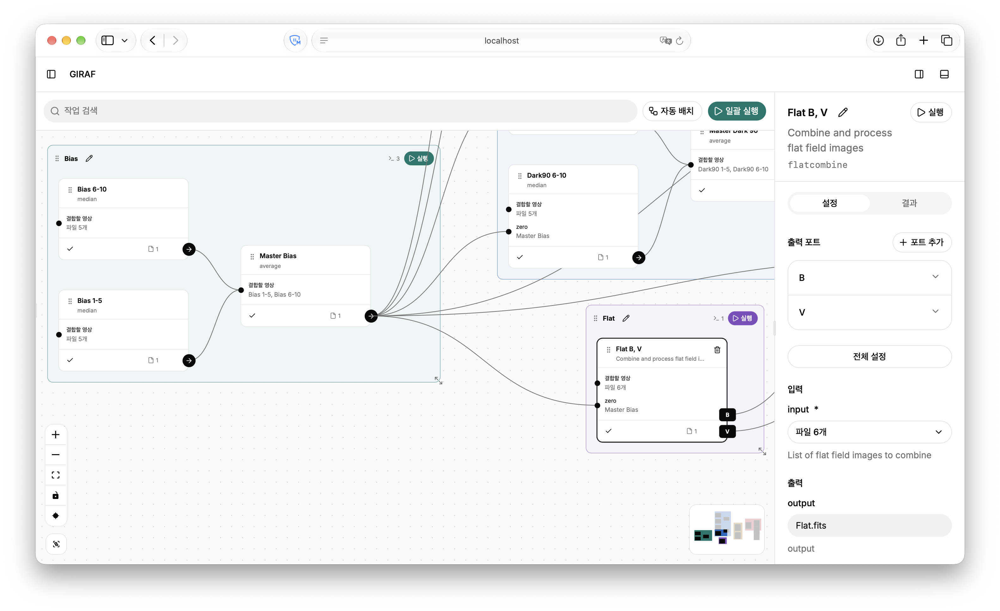

# GIRAF



GIRAF는 [IRAF](https://iraf-community.github.io)를 명령어 대신 화면에서 다루는 앱입니다.

IRAF로 관측 영상을 처리하려면 보통 터미널에 명령을 하나씩 입력해야 합니다. GIRAF에서는 IRAF 작업을 상자(**노드**)로 놓고 선으로 이어서, 어떤 파일이 어떤 작업을 거쳐 어떤 결과가 되는지 보면서 처리합니다. 계산은 컴퓨터에 설치된 IRAF가 그대로 수행합니다.

> [!WARNING]
> GIRAF는 아직 개발 중입니다. IRAF를 직접 실행했을 때와 결과가 완전히 같다고 보장하지 않습니다. 중요한 자료는 결과를 한 번 더 확인해 주세요.

## 주요 기능

- IRAF 작업을 검색해 화면에 놓고, 파라미터를 칸에 입력해 바꿉니다.
- 한 작업의 결과를 선으로 이어 다음 작업에 넘깁니다. 예를 들어 bias를 합친 결과를 dark 보정에 바로 씁니다.
- 쓰던 IRAF 명령을 붙여 넣으면 노드로 만들어집니다.
- FITS 영상을 앱 안에서 열어 보고 두 영상을 비교합니다.
- 원본 파일은 건드리지 않고 사본으로 작업합니다.
- 언제 어떤 설정으로 실행했는지 기록이 남습니다.

## 준비

컴퓨터에 **IRAF**가 설치되어 있어야 합니다. GIRAF에는 IRAF가 들어 있지 않습니다. 아직 없다면 [IRAF 설치 안내](https://iraf-community.github.io/install)를 따라 먼저 설치해 주세요.

## 설치

[Releases 페이지](https://github.com/ys-astro-js/giraf/releases/latest)에서 컴퓨터에 맞는 파일을 내려받습니다.

| 컴퓨터 | 내려받을 파일 |
| --- | --- |
| Mac (Apple 칩) | `.dmg`로 끝나는 파일 |
| Windows | `.exe`로 끝나는 파일 |
| Linux | `.AppImage`로 끝나는 파일 |

**Mac**: `.dmg` 파일을 열고 GIRAF 아이콘을 응용 프로그램 폴더로 끌어다 놓습니다.

**Windows**: GIRAF는 Windows 안의 Linux(WSL)에 설치된 IRAF를 씁니다. WSL과 Linux 배포판(예: Ubuntu)을 설치하고 그 안에 IRAF를 설치한 뒤, `.exe` 파일을 실행해 설치합니다.

**Linux**: 내려받은 파일에 실행 권한을 주고 실행합니다.

```bash
chmod +x GIRAF-*.AppImage
```

설치한 앱은 열 때마다 새 버전을 확인합니다. 새 버전은 백그라운드에서 받아 두었다가 앱을 다시 열 때 설치됩니다.

## 시작하기

1. GIRAF를 열고 관측 파일이 들어 있는 폴더를 고릅니다. 한 번 연 폴더는 다음부터 **최근 폴더**에 나옵니다.
2. 위쪽 도구 막대에서 **작업 추가**를 누르고, `zerocombine`처럼 쓰려는 IRAF 작업 이름을 검색해 화면에 놓습니다.
3. 같은 **작업 추가**에서 **파일 입력**을 놓고 처리할 FITS 파일을 고릅니다.
4. 파일 입력의 오른쪽 동그라미를 작업의 왼쪽 동그라미로 끌어 잇습니다. 이 동그라미를 **포트**라고 합니다. 왼쪽은 받는 곳, 오른쪽은 내보내는 곳입니다.
5. 노드를 누르면 오른쪽 **속성 패널**에 파라미터가 나옵니다. 필요한 값을 바꿉니다.
6. 노드를 고른 채 **Enter**를 누르거나 실행 버튼을 눌러 실행합니다. 여러 작업을 차례로 한 번에 실행하려면 **일괄 실행**을 누릅니다.
7. 아래쪽 **실행 기록**에서 실행 결과와 만들어진 파일을 확인합니다. 결과 영상은 눌러서 바로 열 수 있습니다.

결과를 다음 작업에 쓰려면 그 작업의 오른쪽 포트를 다음 작업의 왼쪽 포트에 잇습니다. 예를 들어 `zerocombine`의 결과를 `darkcombine`의 `zero` 포트에 이으면, 합친 bias로 dark를 보정합니다.

### IRAF 명령으로 노드 만들기

**작업 추가**의 **명령**에 IRAF 명령을 붙여 넣으면 줄마다 노드가 만들어집니다. 앞 줄의 결과를 다음 줄이 쓰면 두 노드가 자동으로 이어집니다. 추가하기 전에 줄마다 무엇이 만들어지는지 먼저 보여 줍니다.

### 단축키

| 동작 | Mac | Windows, Linux |
| --- | --- | --- |
| 작업 추가 | ⌘N | Ctrl+N |
| 고른 노드 실행 | Enter | Enter |
| 노드가 든 그룹 실행 | ⌘Enter | Ctrl+Enter |
| 일괄 실행 | ⇧⌘Enter | Shift+Ctrl+Enter |
| 노드 복사, 붙여 넣기 | ⌘C, ⌘V | Ctrl+C, Ctrl+V |

단축키는 버튼에 마우스를 올려도 나옵니다.

## 원본 파일과 실행 기록

GIRAF는 기본으로 원본 파일을 복사한 **사본**으로 작업하므로 원본은 그대로 남습니다. 설정의 **실행 대상**을 **원본 파일**로 바꾸면 원본이 변경될 수 있습니다.

실행 기록과 결과 파일은 `문서/GIRAF` 폴더에 저장됩니다. Windows에서는 WSL 안의 `~/.giraf/data`에 저장되므로, 결과를 Windows 폴더에 남기려면 파일 저장 노드를 씁니다. 실행마다 입력 파일, 설정, IRAF가 남긴 메시지가 함께 기록됩니다.

## 자주 묻는 질문

### IRAF를 찾지 못한다고 나옵니다

먼저 터미널에서 IRAF가 실행되는지 확인해 주세요. 일반적인 위치에 설치된 IRAF는 자동으로 찾습니다. 다른 곳에 설치했다면 터미널 설정 파일(`~/.zshrc` 또는 `~/.bashrc`)에 IRAF 위치를 적고 GIRAF를 다시 열어 주세요. `/path/to/iraf/`는 실제 IRAF 폴더로 바꿔 적습니다.

```bash
export iraf="/path/to/iraf/"
```

GIRAF를 열어 둔 상태에서 IRAF를 설치했다면 처음 화면의 **실행 환경 다시 확인**을 누릅니다.

### Mac에서 "열 수 없습니다"라고 나옵니다

GIRAF 아이콘을 오른쪽 클릭하고 **열기**를 누릅니다. 한 번 이렇게 열면 다음부터는 그냥 열립니다.

### 실행이 실패합니다

아래쪽 **실행 기록**에서 실패한 실행을 누르고 **로그**를 열면 IRAF가 남긴 오류 메시지가 나옵니다. 입력 파일과 파라미터 값을 확인해 주세요.

노드에 빨간색이나 노란색 표시가 있으면 실행 전에 이미 발견된 문제입니다. 표시된 칸에 마우스를 올리면 이유가 나옵니다.

### 일부 파일만 처리되고 나머지는 건너뜁니다

`ccdtype` 같은 파라미터는 FITS 헤더를 보고 맞는 파일만 처리합니다. 파일의 헤더가 기대한 값(예: `zero`, `dark`, `flat`)과 같은지 확인해 주세요.

### 모든 FITS 영상을 열 수 있나요?

내장 영상 뷰어는 파일의 첫 부분(Primary HDU)에 든 2차원 영상을 표시합니다. 1차원 스펙트럼이나 확장에만 영상이 든 파일은 아직 뷰어로 볼 수 없지만, IRAF 작업의 입력으로는 쓸 수 있습니다.

## 소스 코드로 실행하기 (개발자용)

앱 대신 소스 코드로 실행하려면 [uv](https://docs.astral.sh/uv/getting-started/installation/)와 [Bun](https://bun.sh/docs/installation)이 필요합니다.

```bash
git clone https://github.com/ys-astro-js/giraf.git
```

GIRAF 폴더에서 한 번 설치합니다.

```bash
uv sync --locked && cd web && bun install --frozen-lockfile && bun run build && cd ..
```

GIRAF 폴더에서 실행합니다.

```bash
uv run main.py
```

브라우저에서 [http://127.0.0.1:8501/](http://127.0.0.1:8501/)을 엽니다. 종료하려면 실행한 터미널에서 **Ctrl+C**를 누릅니다. 이 방식으로 실행하면 실행 기록은 GIRAF 폴더의 `runs/`에 저장됩니다.

테스트는 여러 프로세스에서 나눠 실행합니다. 기본으로는 IRAF를 실행하지 않는 테스트만 돌립니다.

```bash
uv run scripts/test.py
```

IRAF를 실제로 실행하는 테스트까지 모두 돌리려면 `--iraf`를 붙입니다. `test_task_map`처럼 이름을 붙이면 그 테스트만 실행합니다.

```bash
uv run scripts/test.py --iraf
```

웹 테스트는 `web` 폴더에서 `bun test`로 실행합니다.

데스크톱 앱을 직접 빌드하거나 새 버전을 배포하는 방법은 [docs/releases.md](docs/releases.md)에 있습니다.

## 라이선스

[MIT](LICENSE)
